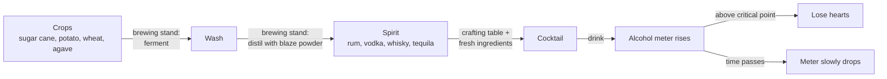

# Cocktail Mod (Minecraft 1.21.1 NeoForge)

A fun and lightweight Minecraft mod that introduces craftable cocktails with unique status effects!

Built for the **BuilderClub hackathon**. The goal: mix **real cocktails** from **real ingredients** in Minecraft. Spirits are distilled in the brewing stand, cocktails are mixed from those spirits plus fresh ingredients, and an **alcohol meter** on screen tracks how drunk you are. Go past the critical point and you start losing hearts.

---

## 📑 Contents

- [Concept](#-concept)
- [Features (current)](#-features)
- [Roadmap](#-roadmap)
- [Game design](#-game-design)
  - [Ingredients: vanilla vs. new](#ingredients-vanilla-vs-new)
  - [Distilling spirits in the brewing stand](#distilling-spirits-in-the-brewing-stand)
  - [Cocktails](#cocktails)
  - [The alcohol meter](#the-alcohol-meter)
  - [Open design decisions](#open-design-decisions)
- [Technical guide (NeoForge 1.21.1)](#-technical-guide-neoforge-1211)
- [Planned project structure](#-planned-project-structure)
- [Things to keep in mind](#-things-to-keep-in-mind)
- [Team workflow & hackathon plan](#-team-workflow--hackathon-plan)
- [Building from Source](#-building-from-source)
- [How to Install & Play in CurseForge](#-how-to-install--play-in-curseforge)
- [Useful links](#-useful-links)

---

## 🍹 Concept



Principles:

- **Real, not fictional.** Every cocktail follows a real recipe (we use the [IBA official cocktail list](https://iba-world.com/) as reference) and every ingredient exists in real life.
- **Reuse vanilla.** If Minecraft already has an ingredient (sugar, honey, milk, eggs, ice…), we use the vanilla item instead of adding a duplicate.
- **Real production chain.** Rum from sugar cane, vodka from potatoes, whisky from grain, tequila from agave, just like in reality.
- **Real numbers.** The alcohol meter is based on grams of alcohol, calculated from the real recipe.

---

## 🍉 Features

### 1. Melon Cocktail
* **Recipe**: Shapeless crafting in any 2×2 or 3×3 grid:
  * `1x Melon Slice` (`minecraft:melon_slice`)
  * `1x Glass Bottle` (`minecraft:glass_bottle`)
* **Behavior**:
  * **Drinkable**: Plays drinking sounds and animation (`UseAnim.DRINK`).
  * **Empty Bottle Return**: Consuming the cocktail returns an empty glass bottle (`minecraft:glass_bottle`) to your hand or inventory.
  * **Always Drinkable**: Can be enjoyed even if your hunger bar is completely full.
* **Status Effect**:
  * Gives **15 seconds of Nausea / Dizziness** (`MobEffects.CONFUSION` / `minecraft:nausea`), causing the camera and screen to wobble in a disorienting, drunken swirl with potion particles.
  * Restores `4` nutrition and `0.3` saturation.
* **Stack Size**: Stacks up to `16` (standard for potions and drinks).
* **Creative Tab**: Found under the custom **Cocktails** tab and the vanilla **Food & Drinks** tab.

> The Melon Cocktail is our first working proof of concept (item, recipe, texture, drink behaviour). The real cocktails below reuse the same drink logic.

---

## 🧭 Roadmap

| # | Milestone | Status |
|---|-----------|--------|
| 0 | Project setup, CI build, first drinkable item (Melon Cocktail) | ✅ Done |
| 1 | Generic `DrinkItem` class (alcohol grams, effects, nutrition as parameters) | ⬜ To do |
| 2 | Alcohol meter: per-player data + `/alcohol` test command | ⬜ To do |
| 3 | Alcohol meter HUD bar | ⬜ To do |
| 4 | Decay over time, warning zone, critical zone with damage | ⬜ To do |
| 5 | New ingredients (lime, mint, agave, …) | ⬜ To do |
| 6 | Brewing stand recipes: wash → spirit | ⬜ To do |
| 7 | MVP cocktails (6) with real recipes | ⬜ To do |
| 8 | Mocktails (alcohol-free variants) | ⬜ To do |
| 9 | Polish: textures, sounds, Dutch translation (`nl_nl.json`), demo world | ⬜ To do |
| 10 | Stretch: shaker item or bar block with its own GUI | ⬜ Stretch |

**Rule of thumb:** one cocktail that works end to end (ingredient → spirit → mix → drink → meter) is worth more than ten half-finished ones.

---

## 🎮 Game design

### Ingredients: vanilla vs. new

**Already in Minecraft (do not re-add):**

| Real ingredient | Vanilla item |
|---|---|
| Sugar | `minecraft:sugar` |
| Honey | `minecraft:honey_bottle` |
| Milk / cream | `minecraft:milk_bucket` |
| Egg white (for sours) | `minecraft:egg` |
| Ice | `minecraft:ice` (optionally craft into an "ice cubes" item) |
| Water | water bottle (`minecraft:potion` with water contents) |
| Apple, melon, berries | `minecraft:apple`, `minecraft:melon_slice`, `minecraft:sweet_berries` |
| Cocoa | `minecraft:cocoa_beans` |
| Base crops for spirits | `minecraft:sugar_cane`, `minecraft:potato`, `minecraft:wheat` |
| Glass | `minecraft:glass_bottle` |

**New items to add:**

| Type | Items | How to obtain (proposal) |
|---|---|---|
| Fruit | lime, lemon, orange, pineapple, coconut | New crops/bushes, or village/jungle chest loot |
| Herbs & plants | mint, agave, juniper berries, ginger | New crops or plants found in specific biomes |
| Intermediates | sugar syrup, soda water, cola, ginger beer, coconut cream | Crafted (e.g. sugar syrup = sugar + water bottle) |
| Liqueurs | triple sec (orange liqueur), coffee liqueur | Spirit + fruit/beans + sugar |
| Brewing steps | sugar cane wash, potato wash, grain wash, agave wash | Brewing stand, step 1 |
| Spirits | white rum, vodka, whisky, tequila, gin | Brewing stand, step 2 |
| Glassware (optional) | highball, cocktail glass, tumbler | Crafted from glass |

### Distilling spirits in the brewing stand

Two steps, like the real process:

| Spirit | Step 1: ferment | Step 2: distil |
|---|---|---|
| White rum | water bottle + **sugar cane** → sugar cane wash | wash + **blaze powder** (= heat) → rum |
| Vodka | water bottle + **potato** → potato wash | wash + **blaze powder** → vodka |
| Whisky | water bottle + **wheat** → grain wash | wash + **blaze powder** → whisky |
| Tequila | water bottle + **agave** → agave wash | wash + **blaze powder** → tequila |
| Gin | — | vodka + **juniper berries** → gin |

Optional realism extras: vodka + charcoal (charcoal filtering), whisky + oak log (barrel ageing).

> ⚠️ Avoid combinations that already exist in vanilla brewing. Water bottle + **sugar** already gives a Mundane Potion, which is why rum uses **sugar cane**.

### Cocktails

**MVP (6 cocktails, lots of shared ingredients):**

| Cocktail | Real recipe (IBA spec, verify at iba-world.com) | Alcohol points* |
|---|---|---|
| Mojito | 45 ml white rum, 20 ml lime juice, mint, sugar, soda water | 14 |
| Daiquiri | 60 ml white rum, 20 ml lime juice, sugar | 19 |
| Cuba Libre | 50 ml white rum, 120 ml cola, 10 ml lime juice | 16 |
| Margarita | 50 ml tequila, 20 ml triple sec, 15 ml lime juice | 22 |
| Moscow Mule | 45 ml vodka, 120 ml ginger beer, 10 ml lime juice | 14 |
| Piña Colada | 50 ml white rum, 30 ml coconut cream, 50 ml pineapple juice | 16 |

**Stretch:** Whiskey Sour (whisky, lemon, sugar syrup, egg white), Espresso Martini (vodka, coffee liqueur, coffee), Gin Fizz.

**Mocktails (0 points):** Virgin Mojito, Virgin Piña Colada, and the existing Melon Cocktail.

\* **Alcohol points = grams of alcohol** = `ml × ABV × 0.8` (0.8 ≈ density of ethanol). Example: 60 ml rum at 40% → 60 × 0.40 × 0.8 ≈ 19. A straight shot of a spirit (40 ml, 40%) ≈ 13 points.

**Crafting simplification:** Minecraft recipes have no quantities, so **1 slot = 1 portion** and each cocktail is a shapeless recipe: spirit(s) + mixers + garnish + glass.

**Effects matched to the real drink** (on top of the alcohol points), for example:
- Espresso Martini → Speed (coffee)
- Mojito → short Regeneration (fresh mint)
- Strong cocktails → brief Nausea

### The alcohol meter

| Setting | Value (proposal) |
|---|---|
| Scale | 0 – 100 points (1 point = 1 gram of alcohol) |
| Points per drink | Alcohol points from the cocktail table |
| Decay | 1 point every ~7 seconds (140 ticks) |
| 🟢 Safe zone | 0 – 39: no effects |
| 🟡 Warning zone | 40 – 59: short Nausea, meter turns yellow |
| 🔴 Critical zone | 60+: lose **half a heart every 2 seconds** |
| On death | Meter resets to 0 |
| Sleeping | Skipping the night removes a large chunk (time passes) |

**Why ~7 seconds?** A body breaks down roughly 7 g of alcohol per hour. One Minecraft hour lasts 50 seconds (a day is 20 minutes), so 7 points per 50 s ≈ 1 point every 7 s.

**Only time sobers you up.** In real life, water, coffee or food do not lower your blood alcohol, so in this mod they don't either. It's a nice educational detail for the jury.

### Open design decisions

Decide these as a team before building:

- [ ] **Can you die from it?** Option A: damage can kill you, with a custom death message. Option B (friendlier): damage stops at 1 heart and you "pass out" (Blindness + Slowness).
- [ ] **What does "losing hearts" mean?** Damage (hearts go down and regenerate) or temporarily lower **max** health (attribute modifier)?
- [ ] **Exact thresholds and decay speed.** Tune during playtesting.
- [ ] **Spirits as custom items or as potions?** See the technical guide; custom items are recommended.
- [ ] **Where do the new fruits/herbs come from?** Crops, biome plants, chest loot or villager trades.

---

## 🧰 Technical guide (NeoForge 1.21.1)

> Everything below targets **Minecraft 1.21.1 + NeoForge 21.1.x + Java 21**, the versions this repo uses. Fabric tutorials and tutorials for newer Minecraft versions (26.x) use different APIs and will not work as-is.

### Golden rule: the server decides, the client draws

All logic (adding points, decay, damage) runs on the **server**. The client only receives the current value and draws the bar.

### 1. Generic drink item

Turn `MelonCocktailItem` into a reusable `DrinkItem` with parameters such as `alcoholPoints`, extra effects and nutrition. In `finishUsingItem`, on the server side (`!level.isClientSide`), add the item's alcohol points to the player's meter. The glass-bottle return logic from the Melon Cocktail can stay as it is.

### 2. Brewing stand recipes

Mojang has no datapack format for brewing recipes, so they are registered in code with **`RegisterBrewingRecipesEvent`** on the **game event bus**. `event.getBuilder()` returns a `PotionBrewing.Builder`.

There are two ways to make spirits:

**Option A: spirits as custom items (recommended).** NeoForge adds `addRecipe(Ingredient input, Ingredient ingredient, ItemStack output)` to the builder, so the brewing stand can produce our own items. That gives every spirit its own texture, and cocktail recipes stay plain JSON with normal item ingredients.

```java
// Sketch, verify against the NeoForge 1.21.1 docs
@SubscribeEvent // game event bus
public static void onRegisterBrewing(RegisterBrewingRecipesEvent event) {
    PotionBrewing.Builder builder = event.getBuilder();

    // A water bottle is a potion item with water contents, so match on that component.
    Ingredient waterBottle = DataComponentIngredient.of(false,
            PotionContents.createItemStack(Items.POTION, Potions.WATER));

    // Step 1: ferment
    builder.addRecipe(waterBottle, Ingredient.of(Items.SUGAR_CANE),
            new ItemStack(ModItems.SUGAR_CANE_WASH.get()));
    // Step 2: distil
    builder.addRecipe(Ingredient.of(ModItems.SUGAR_CANE_WASH.get()), Ingredient.of(Items.BLAZE_POWDER),
            new ItemStack(ModItems.WHITE_RUM.get()));
}
```

> Test early that the brewing stand's bottle slots accept your custom wash items. If they don't, fall back to option B.

**Option B: spirits as potions.** Register each spirit as a `Potion` (via a `DeferredRegister<Potion>`) and use `builder.addMix(inputPotion, ingredientItem, outputPotion)`. It's quick and the bottle is tinted automatically, but:
- `addMix` also creates splash and lingering versions ("Splash Rum").
- All spirits are the item `minecraft:potion`, so cocktail recipes must match on potion contents using the `neoforge:components` ingredient:

```json
{
  "type": "neoforge:components",
  "items": "minecraft:potion",
  "components": { "minecraft:potion_contents": { "potion": "cocktailmod:white_rum" } },
  "strict": false
}
```

- To raise the meter, give the potion a custom **instant** effect (extend `InstantenousMobEffect`, like Instant Health) whose amplifier determines the points.

### 3. Storing the alcohol level (data attachment)

Use a NeoForge **data attachment** on the player:

- Register an `AttachmentType<Integer>` in a `DeferredRegister` for `NeoForgeRegistries.ATTACHMENT_TYPES`.
- `AttachmentType.builder(() -> 0).serialize(Codec.INT).build()` makes it save with the world.
- Do **not** set `copyOnDeath`, so the meter resets when you die.
- Read and write with `player.getData(ALCOHOL)` and `player.setData(ALCOHOL, value)`.

### 4. Syncing to the client

In 1.21.1, attachments are **not synced automatically**. Send a small custom packet whenever the value changes:

- A `record AlcoholSyncPayload(int level) implements CustomPacketPayload` with a `TYPE` and a `STREAM_CODEC`.
- Register it in `RegisterPayloadHandlersEvent` (mod bus) with `playToClient(...)`.
- Send it with `PacketDistributor.sendToPlayer(serverPlayer, new AlcoholSyncPayload(level))`.
- On the client, store the value in a static field (e.g. `ClientAlcoholData.level`) that the HUD reads.
- Also send it when the player logs in, respawns or changes dimension.

### 5. Decay, warning and damage (server tick)

- Listen to `PlayerTickEvent.Post` on the game bus and skip the client side.
- Do the work every 20 ticks (once per second), not every tick.
- **Decay:** subtract 1 point every 140 ticks.
- **Warning zone:** apply a short Nausea effect.
- **Critical zone:** every 40 ticks, deal 1 damage (half a heart) with our own damage type.
- **Sleeping:** `PlayerWakeUpEvent` can remove a large chunk of points.

**Custom damage type** (pure data, no code):

`src/main/resources/data/cocktailmod/damage_type/alcohol_poisoning.json`
```json
{
  "message_id": "cocktailmod.alcohol_poisoning",
  "exhaustion": 0.0,
  "scaling": "never"
}
```

`src/main/resources/data/minecraft/tags/damage_type/bypasses_armor.json` (otherwise armour absorbs the damage)
```json
{
  "values": ["cocktailmod:alcohol_poisoning"]
}
```

Death message in `en_us.json`:
```json
"death.attack.cocktailmod.alcohol_poisoning": "%1$s had one cocktail too many",
"death.attack.cocktailmod.alcohol_poisoning.player": "%1$s had one cocktail too many while fighting %2$s"
```

### 6. The HUD bar

- Register a GUI layer in **`RegisterGuiLayersEvent`** (mod bus, **client only**), e.g. `event.registerAbove(VanillaGuiLayers.HOTBAR, id, layer)`.
- A layer is a `LayeredDraw.Layer`: a lambda `(guiGraphics, deltaTracker) -> { ... }`.
- Version 1 needs no texture. Draw three rectangles with `guiGraphics.fill(x1, y1, x2, y2, argbColor)`: a dark background, a fill in the zone colour (green / yellow / red), and a thin line at the critical point.
- **Placement:** the area above the hotbar is crowded (hearts, armour, hunger, air bubbles, mount health). A **vertical bar next to the hotbar**, like a glass filling up, avoids all of that. Mind the offhand slot and the attack indicator, which can also sit next to the hotbar.
- Hide the bar while the meter is 0, or in spectator/creative mode.

### 7. Test command

Add a debug command via `RegisterCommandsEvent` (game bus), for example `/alcohol set <0-100>` and `/alcohol get`. That way the meter, HUD and damage can be tested without brewing and drinking every time.

---

## 📁 Planned project structure

```
src/main/java/com/hackathon/cocktailmod/
├── CocktailMod.java              # mod entry point, registers everything
├── registry/
│   ├── ModItems.java             # ingredients, washes, spirits, cocktails
│   ├── ModAttachments.java       # alcohol level attachment
│   └── ModBrewing.java           # RegisterBrewingRecipesEvent
├── item/
│   ├── MelonCocktailItem.java    # existing proof of concept
│   └── DrinkItem.java            # generic drinkable item with alcohol points
├── alcohol/
│   ├── AlcoholEvents.java        # tick: decay, warning, damage, wake-up
│   └── AlcoholCommand.java       # /alcohol debug command
├── network/
│   └── AlcoholSyncPayload.java   # server → client sync
└── client/
    ├── ClientAlcoholData.java    # client-side copy of the value
    └── AlcoholHudLayer.java      # draws the meter

src/main/resources/
├── assets/cocktailmod/
│   ├── lang/en_us.json, nl_nl.json
│   ├── models/item/*.json
│   └── textures/item/*.png       # 16×16 pixel art
└── data/
    ├── cocktailmod/recipe/*.json        # cocktail crafting recipes
    ├── cocktailmod/damage_type/alcohol_poisoning.json
    └── minecraft/tags/damage_type/bypasses_armor.json
```

---

## 🚧 Things to keep in mind

- **Alcohol and audience.** Many Minecraft players are young. Include mocktails, don't glorify being drunk (the meter is a *risk* mechanic, not a reward), and check whether the hackathon rules say anything about alcohol.
- **No brand names.** Use generic names: triple sec instead of Cointreau, coffee liqueur instead of Kahlúa, bitter aperitif instead of Aperol/Campari. Some cocktail names are trademarks too (Dark 'n' Stormy belongs to Gosling's).
- **Real vs. playable.** Real recipes use quantities (ml) and techniques (shaken, stirred, built). Crafting has neither; keep it at 1 slot = 1 portion unless we build a shaker or bar block.
- **Recipe conflicts.** Check that new crafting and brewing recipes don't clash with vanilla ones.
- **Version consistency.** Only follow tutorials for **NeoForge 1.21.1**. APIs change a lot between versions (and Fabric is a different loader altogether).
- **Naming.** All IDs lowercase, no spaces, under the `cocktailmod` namespace (e.g. `cocktailmod:white_rum`). Add every new item to `en_us.json` (and `nl_nl.json`).
- **Textures.** 16×16 pixels, consistent style; use real glass shapes (highball, cocktail glass, tumbler). Tools: Blockbench, Aseprite or Piskel.
- **Discoverability.** Players need to find the recipes: a cocktail recipe book item, the vanilla recipe book, or JEI/EMI support.
- **Test often.** Run `./gradlew runClient` after every small change and keep a demo world.

---

## 👥 Team workflow & hackathon plan

**Roles (team of four):**

| Role | Responsibilities |
|---|---|
| Programmer | Items, drink logic, alcohol meter, brewing, networking, HUD |
| Data | Crafting recipe JSONs, damage type, language files, alcohol point table |
| Artist | 16×16 textures for ingredients, spirits, cocktails and the meter |
| Research & presentation | Real recipes and ingredients, demo world, pitch |

**Git:**
- Commit small and often; pull before you start working.
- One feature per branch, merge via pull request.
- CI (`.github/workflows/build.yml`) builds every push and pull request, so a red build means something broke.

**Timeline (relative to the hackathon length):**

1. **Start:** everyone can build and run the project (`./gradlew runClient`).
2. **First quarter:** one cocktail working end to end, plus the meter with the test command and HUD.
3. **Middle:** remaining cocktails, brewing chain, textures, decay and damage.
4. **Last quarter:** polish, mocktails, Dutch translation, optional shaker/bar block.
5. **Final hours:** feature freeze, build the demo world, rehearse the pitch.

---

## 🔨 Building from Source

### Prerequisites
* Java 21+ JDK (tested with Java 21 & GraalVM 23)

### Build the Jar
```bash
./gradlew build
```
The compiled jar will be generated at:
```
build/libs/cocktailmod-1.0.0.jar
```

### Run Directly in Dev Client
```bash
./gradlew runClient
```

---

## 🎮 How to Install & Play in CurseForge

1. Open **CurseForge**.
2. Click **Create Custom Profile** (`+` button).
3. Set:
   * **Profile Name**: `Cocktail Mod Test`
   * **Minecraft Version**: `1.21.1`
   * **Game Type**: `NeoForge`
4. Click **Create**.
5. Once created, right-click the profile (or click `...`) and select **Open Folder**.
6. Place `cocktailmod-1.0.0.jar` into the `mods/` directory.
7. Click **Play** and enjoy crafting your cocktails!

---

## 🔗 Useful links

- [NeoForge docs (1.21.1)](https://docs.neoforged.net/docs/1.21.1/gettingstarted/)
- [Mob effects, potions & brewing (1.21.1)](https://docs.neoforged.net/docs/1.21.1/items/mobeffects)
- [Data attachments (1.21.1)](https://docs.neoforged.net/docs/1.21.1/datastorage/attachments)
- [Ingredients incl. `neoforge:components` (1.21.1)](https://docs.neoforged.net/docs/1.21.1/resources/server/recipes/ingredients)
- [`RegisterGuiLayersEvent` Javadoc](https://nekoyue.github.io/ForgeJavaDocs-NG/javadoc/1.21.x-neoforge/net/neoforged/neoforge/client/event/RegisterGuiLayersEvent.html)
- [`PotionBrewing.Builder` Javadoc](https://nekoyue.github.io/ForgeJavaDocs-NG/javadoc/1.21.x-neoforge/net/minecraft/world/item/alchemy/PotionBrewing.Builder.html)
- [IBA official cocktails](https://iba-world.com/) and the [list on Wikipedia](https://en.wikipedia.org/wiki/List_of_IBA_official_cocktails)
- [Blockbench](https://www.blockbench.net/) (textures and models)
